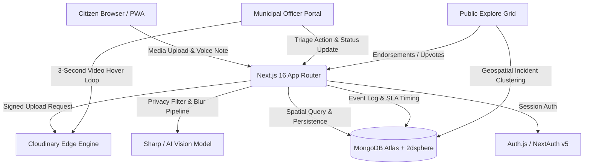

# 🏛️ CivicLens

[](https://nextjs.org/)
[](https://react.dev/)
[](https://www.typescriptlang.org/)
[](https://tailwindcss.com/)
[](https://www.mongodb.com/atlas)
[](https://cloudinary.com/)
[](LICENSE)
[](https://github.com/users/Ankit-Kum-ar/projects/3)

> **Privacy-Preserving, AI-Triaged Citizen Infrastructure & Public Hazard Reporting Engine**  
> Built for SheBuilds / Hacktoberfest 2026 • Track: Empowering Local Communities & Tech for Good

---

## 📌 Project Board & Roadmap

Track ongoing sprints, issue assignments, and feature milestones on our official board:  
👉 **[View the CivicLens Project Board](https://github.com/users/Ankit-Kum-ar/projects/3)**

---

## 📖 Table of Contents

- [Problem Statement](#-problem-statement)
- [Key Features](#-key-features)
- [System Architecture](#-system-architecture)
- [Design System & Aesthetics](#-design-system--aesthetics)
- [Tech Stack](#-tech-stack)
- [Folder Structure](#-folder-structure)
- [Quickstart & Installation](#-quickstart--installation)
- [Environment Configuration](#-environment-configuration)
- [Available Scripts](#-available-scripts)
- [Core Workflows](#-core-workflows)
- [Security & Privacy Model](#-security--privacy-model)
- [Contributing](#-contributing)
- [License](#-license)

---

## 🛑 Problem Statement

Urban civic reporting systems often fail because of high citizen friction, lack of data privacy, and overwhelming operational overhead for municipal authorities:

1. **Bystander Privacy Breaches**: Photos and videos uploaded by citizens frequently expose innocent faces, private vehicle license plates, and residential addresses to public feeds.
2. **Video Triage Bottlenecks**: Municipal staff cannot realistically download and watch dozens of 20MB–50MB videos submitted by citizens to evaluate urgency.
3. **Complex Geospatial Failures**: Traditional civic apps crash during concurrent map navigation or provide static non-responsive tabular views.
4. **Accountability Deficit**: Citizens submit grievances into a "black hole" with no transparent SLA tracking or public endorsement system.

**CivicLens** solves these issues with automatic edge privacy redaction, high-definition 3-second hover video loops, real-time geospatial risk heatmaps, and role-based municipal triage consoles.

---

## ✨ Key Features

### 👤 Citizen Portal (`/` & `/report`)
- **1-Tap Authentication**: Secure Google OAuth & password-free session management via Auth.js (NextAuth v5).
- **Zero-Friction Intake**: Drag-and-drop support for high-res images and MP4/MOV videos with live progress indicators.
- **Multimodal Voice Notes**: Built-in audio recorder capturing citizen voice memos alongside visual media.
- **Auto Geocoding & GPS Pinning**: Browser GPS integration with automatic ward detection and fallback coordinates.
- **Citizen Activity Feed**: Personal history with status badges, endorsement counts, and community reputation tracking.

### 🛡️ Privacy Redaction Pipeline
- **Automated Bystander Protection**: Background AI detection and blur of bystander faces and vehicle license plates before media enters the public feed.
- **Visual Privacy Badges**: Clear badges informing citizens and municipal engineers that media has been securely redacted.

### ⚡ Municipal Authority Triage Portal (`/admin/dashboard`)
- **Role-Based Routing**: Automatic redirection of municipal engineers (`ADMIN` / `MUNICIPAL_OFFICER`) directly to the triage hub.
- **High-Definition Triage Grid**: 16:9 card layout allowing officers to view high-res incident media at a glance.
- **3-Second Animated Hover Video Clips**: Moving the cursor over any video hazard automatically plays a 3-second animated looping mini-clip without downloading heavy files.
- **Instant Status Workflow**: Single-click transitions (`OPEN` → `DISPATCH CREW` → `RESOLVED` → `REJECTED`) with optimistic UI feedback.
- **Multi-Vector Filtering**: Filter across search terms, severity levels (High/Medium/Low), wards, and categories.

### 🗺️ Public Geospatial Grid & Heatmap (`/explore`)
- **Crash-Free Leaflet GIS Lifecycle**: Custom Leaflet mount lifecycle preventing container re-use and `_leaflet_pos` errors.
- **Interactive Marker Clustering**: Color-coded map pins by urgency with an interactive side preview drawer.
- **Community Endorsements**: "Endorse / I'm Affected" upvoting mechanism to elevate critical civic hazards.

### 🎨 Dark & Light Mode Support
- Seamless theme switching across all pages using `next-themes` and DashStack UI color tokens.

---

## 🏗️ System Architecture



---

## 🎨 Design System & Aesthetics

CivicLens adheres to the **DashStack** design system:
- **Primary Brand**: `#4880FF` (Civic Blue)
- **Success / Resolved**: `#00B69B` (Emerald Green)
- **In-Progress / Warning**: `#FF9F43` (Amber Orange)
- **High Severity / Urgent**: `#EF3826` (Crimson Red)
- **Card Styling**: `rounded-2xl`, subtle borders (`border-border`), clean glassmorphism, responsive CSS grid.
- **Typography**: Inter / Sans font stack with high-contrast foreground hierarchy.

---

## 🛠️ Tech Stack

| Domain | Technology | Purpose |
|---|---|---|
| **Framework** | [Next.js 16.4.2](https://nextjs.org/) (Turbopack) | Modern server components, dynamic routing, caching |
| **Library** | [React 19.3.0](https://react.dev/) | Core UI library with Actions and Suspense boundaries |
| **Language** | [TypeScript 5](https://www.typescriptlang.org/) | Strict type safety across all components and server actions |
| **Styling** | [Tailwind CSS v4](https://tailwindcss.com/) & [shadcn/ui](https://ui.shadcn.com/) | Design tokens, utility-first layouts, accessible components |
| **Theming** | [next-themes](https://github.com/pacocoursey/next-themes) | System-aware Dark and Light mode toggles |
| **Auth** | [Auth.js / NextAuth v5](https://authjs.dev/) | Role-based authentication (CITIZEN, MUNICIPAL_OFFICER, ADMIN) |
| **Database** | [MongoDB Atlas](https://www.mongodb.com/atlas) + Mongoose 9 | Document storage with geospatial `2dsphere` indexes |
| **Media & CDN** | [Cloudinary](https://cloudinary.com/) | Edge storage, signed video upload, responsive delivery |
| **Mapping** | [Leaflet](https://leafletjs.com/) | Interactive vector tiles and GIS incident markers |
| **Icons** | [Lucide React](https://lucide.dev/) | Modern, crisp UI iconography |

---

## 📂 Folder Structure

```text
civilens/
├── src/
│   ├── actions/                  # Server Actions (zero-API client RPC)
│   │   ├── admin.ts              # Municipal triage & status change mutations
│   │   ├── dashboard.ts          # Citizen dashboard KPI metrics aggregator
│   │   └── grievance.ts          # Grievance creation, query, and upvotes
│   ├── app/                      # Next.js App Router routes
│   │   ├── admin/dashboard/      # Municipal Officer Triage Console
│   │   ├── api/                  # API endpoints (Auth, Health, Cloudinary)
│   │   ├── explore/              # Interactive GIS Map & Public Incident Grid
│   │   ├── my-reports/           # Citizen personal submission dashboard
│   │   ├── report/               # Citizen multi-step incident reporting portal
│   │   │   └── [id]/             # Detailed incident view with video player
│   │   ├── layout.tsx            # Global layout with ThemeProvider & Sonner
│   │   └── page.tsx              # Adaptive landing page (Citizen vs Public)
│   ├── components/               # Modular UI Component Library
│   │   ├── admin/                # Admin triage headers, metric cards, grid/table
│   │   ├── dashboard/            # Citizen KPI cards, recent activity, quick actions
│   │   ├── explore/              # Leaflet map, filters, incident cards, drawer
│   │   ├── report/               # Dropzone, voice recorder, category picker
│   │   └── ui/                   # Reusable atomic UI & HoverVideoPreview
│   ├── constants/                # Categories, departments, severity levels
│   ├── database/                 # Mongoose schemas (Grievance, User, ActivityLog)
│   ├── lib/                      # Database connectors, logger, media utilities
│   └── types/                    # Shared TypeScript definitions
├── public/                       # Static assets and icons
├── .env.example                  # Environment configuration template
├── package.json                  # Dependencies and scripts
└── tsconfig.json                 # TypeScript compiler configuration
```

---

## 🏁 Quickstart & Installation

### Prerequisites
- Node.js 20.x or higher
- npm 10.x or higher
- A free [MongoDB Atlas](https://www.mongodb.com/atlas) database cluster
- A free [Cloudinary](https://cloudinary.com/) account for media hosting

### 1. Clone the repository
```bash
git clone https://github.com/Ankit-Kum-ar/civiclens.git
cd civiclens
```

### 2. Install dependencies
```bash
npm install
```

### 3. Configure environment variables
Copy the template and fill in your credentials:
```bash
cp .env.example .env.local
```

### 4. Run the development server
```bash
npm run dev
```

Visit [http://localhost:3000](http://localhost:3000) in your browser.

---

## ⚙️ Environment Configuration

Create a `.env.local` file in the root directory with the following variables:

```ini
# Application URL
APP_URL="http://localhost:3000"

# Default Geolocation Fallbacks
DEFAULT_LAT="28.6139"
DEFAULT_LNG="77.2090"
DEFAULT_WARD="Ward 32"
DEFAULT_CITY="New Delhi"

# MongoDB Database Connection
MONGODB_URI="mongodb+srv://<username>:<password>@cluster0.mongodb.net/civiclens?retryWrites=true&w=majority"

# Authentication (NextAuth v5 / Auth.js)
AUTH_SECRET="your-32-character-random-secret"
AUTH_URL="http://localhost:3000"
AUTH_GOOGLE_ID="your-google-oauth-client-id.apps.googleusercontent.com"
AUTH_GOOGLE_SECRET="your-google-oauth-client-secret"

# Comma-separated Municipal Admins
ADMIN_EMAILS="admin@civiclens.org,officer@delhi.gov.in"

# Cloudinary Media Configuration
CLOUDINARY_CLOUD_NAME="your-cloud-name"
CLOUDINARY_API_KEY="your-api-key"
CLOUDINARY_API_SECRET="your-api-secret"
CLOUDINARY_UPLOAD_PRESET="civiclens_signed_preset"
```

---

## 📜 Available Scripts

| Command | Description |
|---|---|
| `npm run dev` | Starts the Next.js development server with Turbopack |
| `npm run build` | Compiles an optimized production build with Partial Prerendering |
| `npm run start` | Runs the compiled production build |
| `npm run lint` | Runs ESLint 9 across all TypeScript and React files |
| `npm run typecheck` | Validates TypeScript types across the entire project (`tsc --noEmit`) |

---

## 🔑 Demo Trial Access (Evaluators & Testers)

For quick hackathon evaluation without registering a new account, use the pre-configured trial credentials directly on `/login` (with 1-click **Auto-fill** support):

| Role | Email | Password | Access Area |
|---|---|---|---|
| **Citizen Reporter** | `aarav.citizen@civiclens.gov` | `Password123!` | `/` (Citizen Dashboard), `/report`, `/my-reports` |
| **Municipal Officer** | *(Google Auth or configured ADMIN_EMAILS)* | Google SSO | `/admin/dashboard` (Triage Hub) |

---

## 🔄 Core Workflows

### 1. Filing an Incident Report
1. Citizen navigates to `/report`.
2. Uploads an image or video file via the drag-and-drop zone.
3. Optionally records a voice note describing the hazard.
4. Selects an infrastructure category (e.g. *Open Manhole*, *Pothole*, *Streetlight Outage*, *Waterlogging*).
5. The system automatically tags current GPS coordinates, redacts sensitive bystanders, and generates a permanent ticket ID.

### 2. Municipal Officer Triage
1. Authorized municipal staff logs in and is routed to `/admin/dashboard`.
2. Triage board presents key metrics: *Pending Triage*, *In Progress*, *Resolved*, and *High Urgency*.
3. Officer selects **Grid View** to preview 3-second animated video loops or high-res photos.
4. Changes status to `Dispatch Crew` (`IN_PROGRESS`) or `Mark Resolved` (`RESOLVED`).
5. An audit log is automatically appended to the incident document.

### 3. Public Verification & Exploration
1. Citizens view live hazard locations on the GIS map at `/explore`.
2. Community members can upvote or endorse issues using the "Endorse" button.
3. Inspects full resolution video and SLA countdown on `/report/[id]`.

---

## 🔒 Security & Privacy Model

- **Edge Facial & License Plate Redaction**: Bystanders caught in photos or videos are sanitized before entering public queries.
- **Server Actions & CSRF Protection**: All mutations utilize Next.js Server Actions with built-in origin validation.
- **Role-Based Authorization**: Administrative actions (`updateGrievanceStatusAction`) verify the session user's role server-side.
- **Safe Media Delivery**: Direct signed streaming tokens prevent hotlinking or unauthorized file tampering.

---

## 🤝 Contributing

Contributions are welcome! Please follow these steps:

1. Fork the repository.
2. Create a feature branch: `git checkout -b feature/amazing-feature`.
3. Commit your changes: `git commit -m "feat: add amazing feature"`.
4. Ensure checks pass: `npm run lint && npm run typecheck`.
5. Push to the branch: `git push origin feature/amazing-feature`.
6. Open a Pull Request referencing the relevant task on the [Project Board](https://github.com/users/Ankit-Kum-ar/projects/3).

---

## 📄 License

This project is licensed under the MIT License — see the [LICENSE](LICENSE) file for details.
