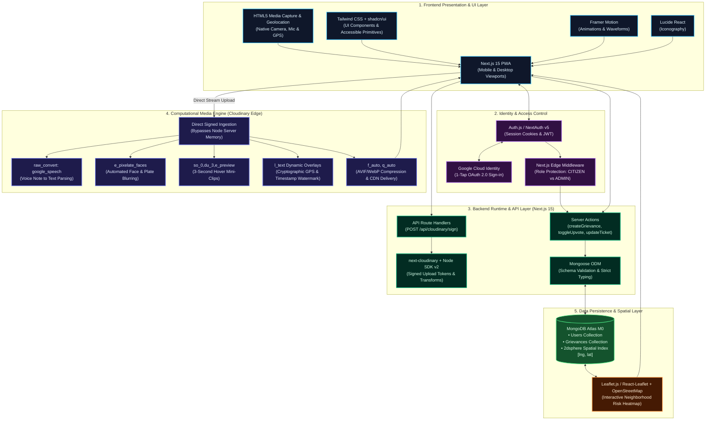

# CivicLens: Privacy-Compliant, AI-Triaged Citizen Infrastructure Reporting
> **Hacktober HackDays 2026 Developer Handbook & System Specification**  
> **Track:** Empowering Local Communities / Tech for Good  
> **Stack:** Next.js 15 (PWA), Auth.js (NextAuth v5), MongoDB Atlas, Cloudinary Media Engine, Leaflet.js

---

## 1. Executive Summary & Core Philosophy

**CivicLens** is an open-source, community-first municipal grievance intake and triage engine designed to bridge the gap between active civic engagement and actionable municipal intervention.

Traditional civic portals fail not from a lack of citizen reporting, but from **intake bottlenecks**: unredacted private bystander data that exposes cities to severe privacy liabilities, alongside multi-megabyte raw media dumps that trigger **triage paralysis** among municipal field engineers.

CivicLens decouples media streaming from application server memory. Using standard HTML5 mobile hardware APIs inside a **Next.js 15 Progressive Web App (PWA)**, citizens upload short 10-second videos or photos paired with spoken voice notes directly to **Cloudinary's computational edge pipeline**. The platform automatically sanitizes bystander privacy via computer vision, transcribes spoken vernacular descriptions into structured keyword tags, renders 3-second animated previews for instant administrative review, and stamps tamper-proof cryptographic telemetry directly onto assets.

---

## 2. The Comprehensive Problem Statement & Real-World Proof

### 2.1 The Core Dilemmas

Municipal grievance portals (e.g., 311 systems in the US/UK, MCD 311, and Swachhata apps in India) experience a recurring failure pattern across three structural vectors:

```
[ Citizen Records Street Hazard ]
               │
               ▼
   ┌──────────────────────────────────────────────┐
   │ Inadvertently Captures:                      │
   │ • Innocent bystander & school children faces │
   │ • Civilian vehicle license plates            │
   │ • Private residence doors & house numbers    │
   │ • Heavy, shaky 30MB-50MB raw video files     │
   └──────────────────────────────────────────────┘
               │
      ┌────────┴────────┐
      ▼                 ▼
[ Compliance Dilemma ]  [ Operational Dilemma ]
Strict Privacy Laws     Triage Paralysis
(DPDP Act 2023 / GDPR)  Thousands of 30MB videos
Authorities lock or     Ward engineers cannot manually
reject public feed      review; backlog explodes
      │                 │
      └────────┬────────┘
               ▼
      [ System Breakdown ]
      >50% complaints unresolved
      Hazards persist for months
      Public trust collapses
```

#### A. The Public Evidence & Privacy Paradox (Legal Risk)
When a resident captures a physical street hazard (e.g., an exposed live wire or a crater-sized pothole), the recording device indiscriminately captures personally identifiable information (PII): pedestrian faces, minors, house numbers, and vehicle license plates. 

Under modern global data privacy statutes—such as India's **Digital Personal Data Protection Act (DPDP Act 2023)** and the European Union's **GDPR**—publishing unredacted PII on open public grievance feeds makes municipal corporations directly liable for unlawful data exposure. To avoid legal disputes, municipal IT departments enforce one of two destructive compromises:
1. **The Black Box Compromise:** Media is sealed behind internal access gates. The public cannot view, verify, or upvote issues, eliminating public transparency.
2. **The Rejection Compromise:** Ambiguous reports containing private citizens are summarily closed or rejected without field inspection.

#### B. Triage Paralysis & Cellular Bandwidth Saturation
Municipal engineering divisions operate under severe labor constraints. Ward engineers receive hundreds of unorganized 10MB to 50MB smartphone files daily, usually accompanied by vague text descriptions (e.g., *"road broken near corner"*). Downloading and scrubbing through dozens of shaky 30-second videos is operationally impossible for understaffed municipal crews. High-risk, life-threatening hazards (e.g., missing sewer covers in flooded streets) sit in the same queue as minor cosmetic issues (e.g., unpruned branches).

#### C. The Digital Literacy & Vernacular Language Barrier
Conventional civic forms require citizens to select department categories from multi-tier dropdown menus, determine administrative ward numbers, and compose detailed text descriptions in English. This creates a severe accessibility barrier for non-English speakers, elderly citizens, and informal laborers. Empirical studies show that multimodal voice-and-video capture increases civic reporting rates up to fourfold among historically underrepresented demographics.

### 2.2 Documented Empirical Evidence & Citations

1. **Privacy Leaks on Open Municipal Feeds:** Audits of open municipal datasets show thousands of residential license plates and bystander faces exposed on unredacted civic portals, prompting regulatory scrutiny and civil liberties challenges demanding automated facial masking.
2. **Audit Findings on Municipal Backlogs:** Urban governance performance audits (including findings by independent civic oversight groups and state audit reports) reveal that over 50% of registered citizen complaints are marked "resolved" or "untraceable" without empirical visual proof due to validation bottlenecks.
3. **The Mobile Web Paradigm:** According to modern app usage telemetry, over 80% of urban residents decline to install a standalone 50MB+ native mobile application for single-instance public service reports, necessitating a frictionless, browser-accessible Progressive Web App.

---

## 3. The Proposed Solution: CivicLens

CivicLens transforms mobile browsers into an automated field-triage terminal without requiring App Store downloads, complex text forms, or manual photo-editing tools:

* **For the Citizen (Reporter):** Authenticates via 1-tap Google OAuth, records a 10-second video or photo while speaking naturally in their local dialect, and submits directly to Cloudinary. They receive an instant privacy-sanitized confirmation card with an immutable tracking ID.
* **For the Ward Engineer (Admin):** Views an administrative triage portal featuring **3-second hover-activated previews**, automated keyword tags (`#OpenManhole`, `#ExposedWire`), and an urgency indicator. Engineers can dispatch repair crews with a single click.
* **For the Local Community (Public):** Interacts with an open Leaflet risk heatmap displaying 100% privacy-compliant (blurred) evidence cards, upvotes existing tickets via an **"I'm Affected"** counter to prevent duplicate filings, and reviews completed repairs through an interactive **Before & After slider**.

---

## 4. End-to-End System Workflows (Mermaid Diagrams)

### 4.1 Citizen Reporting & Media Ingestion Flow

```mermaid
sequenceDiagram
    autonumber
    actor Citizen as Rahul (Citizen / Reporter)
    participant PWA as Next.js PWA (Mobile Browser)
    participant Auth as NextAuth.js (/api/auth)
    participant NextServer as Next.js Server Actions
    participant Cloudinary as Cloudinary Edge Engine
    participant MongoDB as MongoDB Atlas

    %% Phase 1: Authentication
    rect rgb(15, 23, 42)
        note over Citizen, MongoDB: Phase 1: 1-Tap Frictionless Authentication
        Citizen->>PWA: Opens app & taps "Report Hazard"
        alt Not Logged In
            PWA->>Citizen: Bottom drawer prompt: "Continue with Google"
            Citizen->>PWA: Taps "Continue with Google"
            PWA->>Auth: Initiates Google OAuth exchange
            Auth->>MongoDB: Upsert User (name, email, role: "CITIZEN")
            Auth-->>PWA: Sets encrypted JWT session cookie
        else Already Logged In
            PWA->>PWA: Reads existing session cookie
        end
    end

    %% Phase 2: Ingestion & Cloudinary Pipeline
    rect rgb(30, 27, 75)
        note over Citizen, Cloudinary: Phase 2: Direct Signed Streaming
        PWA->>Citizen: Requests Camera & GPS access
        Citizen->>PWA: Records 10s video & speaks issue aloud
        PWA->>NextServer: POST /api/cloudinary/sign (Request signed token)
        NextServer-->>PWA: Returns signed timestamp, API key & params
        
        PWA->>Cloudinary: Direct POST: Video binary + raw_convert: google_speech
        note over Cloudinary: Cloudinary processes upload:<br/>1. Executes speech-to-text (Google Speech)<br/>2. Mints public_id (e.g., civiclens/hz_102)<br/>3. Prepares e_pixelate_faces on delivery
        Cloudinary-->>PWA: Returns { public_id, secure_url, transcript }
    end

    %% Phase 3: Database Persistence
    rect rgb(6, 78, 59)
        note over PWA, MongoDB: Phase 3: Database Persistence & Feedback
        PWA->>NextServer: Server Action: createGrievance(public_id, transcript, GPS)
        note over NextServer: Parses transcript for keyword tags<br/>(#OpenManhole, #Urgent) & computes severity
        NextServer->>MongoDB: Grievance.create({ reportedBy: userId, publicId, status: "OPEN", ... })
        MongoDB-->>NextServer: Confirms write (Ticket ID: #CL-8921)
        NextServer-->>PWA: Returns success & ticketId
        PWA->>Citizen: Renders /report/[id] (Sanitized preview & tracking ID)
    end

    %% Phase 4: My Reports & Community Engagement
    rect rgb(49, 46, 129)
        note over Citizen, MongoDB: Phase 4: My Reports & Community Upvoting
        Citizen->>PWA: Visits "/my-reports" or "/explore"
        PWA->>MongoDB: Fetch grievances where reportedBy == userId
        MongoDB-->>PWA: Returns tickets with live statuses
        PWA->>Citizen: Displays tracking timeline (Open -> Dispatched -> Resolved)
        
        opt Neighbor Upvoting
            Citizen->>PWA: Taps "I'm Affected" on another community pin
            PWA->>NextServer: Server Action: toggleUpvote(ticketId)
            NextServer->>MongoDB: Atomic update: $addToSet { upvotedBy: userId }, $inc { upvotesCount: 1 }
            MongoDB-->>PWA: Updated upvote counter
        end
    end
```



---

### 4.2 Municipal Engineer Triage & Resolution Flow

```mermaid
sequenceDiagram
    autonumber
    actor Admin as Municipal Engineer (Admin)
    participant Desktop as Next.js Desktop Dashboard
    participant Middleware as Next.js Route Guard (middleware.ts)
    participant NextServer as Next.js Server Actions
    participant MongoDB as MongoDB Atlas
    participant Cloudinary as Cloudinary Edge Engine

    %% Admin Authentication & Authorization
    rect rgb(69, 10, 10)
        note over Admin, Middleware: Phase 1: Admin Route Protection
        Admin->>Desktop: Navigates to /admin/dashboard
        Desktop->>Middleware: Checks session token
        alt Role is CITIZEN or Unauthenticated
            Middleware-->>Desktop: 403 Forbidden / Redirect to login
        else Role is ADMIN
            Middleware-->>Desktop: Allows access to route
        end
    end

    %% High-Speed Triage
    rect rgb(67, 20, 7)
        note over Desktop, Cloudinary: Phase 2: Instant Triage via 3-Second Previews
        Desktop->>NextServer: Fetch open grievances (status: "OPEN", sort: severity)
        NextServer->>MongoDB: Grievance.find({ status: "OPEN" }).sort({ severity: -1 })
        MongoDB-->>NextServer: Returns ticket list + Cloudinary publicIds
        NextServer-->>Desktop: Renders triage card grid
        
        Admin->>Desktop: Hovers cursor over a ticket card
        note over Desktop, Cloudinary: No 30MB video is downloaded!
        Desktop->>Cloudinary: GET .../video/upload/so_0,du_3,e_preview/hz_102.mp4
        Cloudinary-->>Desktop: Streams 3-second animated mini-clip directly from CDN
        Admin->>Desktop: Reviews auto-tags (#OpenManhole, #Urgent) & spoken transcript
    end

    %% Dispatch & Work Order
    rect rgb(20, 83, 45)
        note over Admin, MongoDB: Phase 3: Work Order & Crew Dispatch
        Admin->>Desktop: Selects status: "IN_PROGRESS" & clicks "Dispatch Crew"
        Desktop->>NextServer: Server Action: updateTicketStatus(ticketId, "IN_PROGRESS")
        NextServer->>MongoDB: Grievance.findByIdAndUpdate(ticketId, { status: "IN_PROGRESS" })
        MongoDB-->>NextServer: Confirms update
        Desktop->>Admin: Generates privacy-safe field link/PDF for maintenance truck
    end

    %% Resolution & Public Verification
    rect rgb(30, 27, 75)
        note over Admin, Cloudinary: Phase 4: Resolution & Before/After Proof
        Admin->>Desktop: Repair complete -> Uploads "Fixed" photo
        Desktop->>Cloudinary: Signed upload: resolution_photo.jpg
        Cloudinary-->>Desktop: Returns resolvedPublicId
        
        Desktop->>NextServer: Server Action: resolveGrievance(ticketId, resolvedPublicId)
        NextServer->>MongoDB: Grievance.findByIdAndUpdate(ticketId, { status: "RESOLVED", resolvedMediaPublicId })
        MongoDB-->>NextServer: Saved
        NextServer-->>Desktop: Ticket marked "RESOLVED"
        
        note over Desktop, Cloudinary: Public Map (/explore) immediately reflects:<br/>1. Pin turns GREEN<br/>2. Before/After slider activates for community verification
    end
```



---

## 5. Cloudinary as the Core Computational Middleware

Cloudinary does not function as passive blob storage in CivicLens; it is the **active edge computer** performing computer vision, audio processing, dynamic layered watermarking, and bandwidth optimization:

| Transformation / Capability | Cloudinary API / URL Parameter | System Function | Free Tier Viability |
| :--- | :--- | :--- | :--- |
| **Automated Privacy Redaction** | `e_pixelate_faces` | Detects and blurs bystander faces and vehicle plates across images and video frames. | **100% Free** (Standard AI Effect) |
| **Speech-to-Text Audio Parsing** | `raw_convert: "google_speech"` | Automatically extracts spoken voice notes into clean string transcripts on ingestion. | **Free Add-on** (Configurable in Dashboard) |
| **Hover Triage Mini-Clip** | `so_0,du_3,e_preview` | Synthesizes an ultra-lightweight 3-second animated preview clip directly at the CDN edge. | **100% Free** (Video transformation) |
| **Tamper-Proof Geotag Badge** | `l_text:Inter_18_bold:...` | Dynamically overlays immutable GPS coordinates, ward numbers, and ticket IDs directly onto the visual asset. | **100% Free** (Standard layer overlay) |
| **Adaptive Edge Delivery** | `f_auto, q_auto` | Selects optimal format (AVIF/WebP) and compression based on the client's network speed. | **100% Free** (Default CDN capability) |

---

## 6. Complete Technology Stack & Architecture



---

## 7. Data Models & Schemas (MongoDB Atlas)

### 7.1 User Model (`models/User.ts`)
```typescript
import mongoose, { Schema, Document, Model } from "mongoose";

export interface IUser extends Document {
  name: string;
  email: string;
  image?: string;
  role: "CITIZEN" | "ADMIN";
  createdAt: Date;
  updatedAt: Date;
}

const UserSchema = new Schema<IUser>(
  {
    name: { type: String, required: true },
    email: { type: String, required: true, unique: true, index: true },
    image: { type: String },
    role: { type: String, enum: ["CITIZEN", "ADMIN"], default: "CITIZEN" },
  },
  { timestamps: true }
);

export const User: Model<IUser> =
  mongoose.models.User || mongoose.model<IUser>("User", UserSchema);
```

### 7.2 Grievance Model (`models/Grievance.ts`)
```typescript
import mongoose, { Schema, Document, Model } from "mongoose";

export interface IGrievance extends Document {
  reportedBy: mongoose.Types.ObjectId;
  cloudinaryPublicId: string;
  resourceType: "video" | "image";
  secureUrl: string;
  transcript?: string;
  tags: string[];
  severity: "LOW" | "MEDIUM" | "HIGH";
  location: {
    type: "Point";
    coordinates: [number, number]; // [Longitude, Latitude] for GeoJSON
    address?: string;
    ward?: string;
  };
  status: "OPEN" | "IN_PROGRESS" | "RESOLVED";
  upvotedBy: mongoose.Types.ObjectId[];
  upvotesCount: number;
  resolvedMediaPublicId?: string;
  createdAt: Date;
  updatedAt: Date;
}

const GrievanceSchema = new Schema<IGrievance>(
  {
    reportedBy: { type: Schema.Types.ObjectId, ref: "User", required: true, index: true },
    cloudinaryPublicId: { type: String, required: true },
    resourceType: { type: String, enum: ["video", "image"], default: "image" },
    secureUrl: { type: String, required: true },
    transcript: { type: String, default: "" },
    tags: [{ type: String, index: true }],
    severity: { type: String, enum: ["LOW", "MEDIUM", "HIGH"], default: "MEDIUM", index: true },
    location: {
      type: { type: String, enum: ["Point"], default: "Point" },
      coordinates: { type: [Number], required: true }, // [lng, lat]
      address: { type: String, default: "Reported Field Location" },
      ward: { type: String, default: "Ward 32" },
    },
    status: {
      type: String,
      enum: ["OPEN", "IN_PROGRESS", "RESOLVED"],
      default: "OPEN",
      index: true,
    },
    upvotedBy: [{ type: Schema.Types.ObjectId, ref: "User" }],
    upvotesCount: { type: Number, default: 0 },
    resolvedMediaPublicId: { type: String },
  },
  { timestamps: true }
);

// 2dsphere index for radius/proximity queries on map
GrievanceSchema.index({ location: "2dsphere" });

export const Grievance: Model<IGrievance> =
  mongoose.models.Grievance || mongoose.model<IGrievance>("Grievance", GrievanceSchema);
```

---

## 8. Screen-by-Screen UI Blueprint

### Screen 1: Mobile Reporting Interface (`/`)
* **Header:** Civic branding ("CivicLens"), active GPS location pill (`📍 Mayur Vihar Phase 1, Ward 32`), and citizen user avatar.
* **Viewport Trigger:** High-contrast capture trigger (`<input type="file" accept="video/*,image/*" capture="environment" />`).
* **Audio Waveform:** Real-time Framer Motion waveform component providing visual feedback during vocal note capture.
* **Direct Upload CTA:** Generates signed parameters via `/api/cloudinary/sign` and streams the binary payload directly to Cloudinary.

### Screen 2: Real-Time Privacy & Triage Feedback (`/report/[id]`)
* **Step-by-step Status Pipeline:**
  * `✔ Uploaded to Media Engine`
  * `✔ Anonymizing bystander faces & plates (e_pixelate_faces)... Done`
  * `✔ Transcribing spoken voice note (google_speech)... Done`
  * `✔ Digital Geotag Badge stamped`
* **Before / After Verification Toggle:** Displays the raw uploaded frame side-by-side with the blurred, privacy-compliant view.
* **Structured Tag Card:** Automatically parsed tags (`#OpenManhole`, `#SchoolZone`) and calculated severity score (`HIGH`).

### Screen 3: Municipal Engineer Dashboard (`/admin/dashboard`)
* **Protected by Middleware:** Only sessions with `role === "ADMIN"` can view.
* **KPI Metrics Strip:** Active Open Tickets, High-Severity Alerts, Average Turnaround Time.
* **High-Speed Triage Grid:**
  * Each card displays hazard tags, ward numbers, and time elapsed.
  * **Hover Trigger:** Moving the mouse over any card plays a smooth, lightweight 3-second animated preview snippet (`so_0,du_3,e_preview`) without downloading the raw file.
* **Dispatch Controls:** Dropdown to change status (`OPEN` $\rightarrow$ `IN_PROGRESS` $\rightarrow$ `RESOLVED`) and an action to export a sanitized field work-order sheet.

### Screen 4: Public Neighborhood Transparency Map (`/explore`)
* **Interactive Leaflet Map:** Renders severity-coded markers (Red = Open, Yellow = Dispatched, Green = Resolved).
* **Upvote Action:** Logged-in citizens can tap **"I'm Affected"**, atomically incrementing the count to prioritize neighborhood impact.
* **Resolution Proof Slider:** Resolved tickets activate an interactive slider showing the original blurred hazard alongside the field crew's completed repair photo.

---

## 9. Hackathon Judging Matrix & Notion Strategy

| Judging Criteria | Weight | Defense & Implementation in CivicLens |
| :--- | :---: | :--- |
| **Problem Statement & Solution** | **50%** | Solves documented DPDP/GDPR compliance bottlenecks and eliminates manual triage delays with clear real-world citations and measurable economic impact. |
| **Cloudinary Integration** | **30%** | Employs Cloudinary as an indispensable computer vision and edge-processing engine (`e_pixelate_faces`, `google_speech`, `e_preview`, `l_text`, `f_auto, q_auto`). If Cloudinary is removed, the system fails. |
| **Notion Documentation** | **20%** | Comprehensive Architectural Decision Records (ADRs) explaining direct-to-cloud signed uploads, PWA vs. native mobile trade-offs, and bandwidth cost-reduction calculations. |